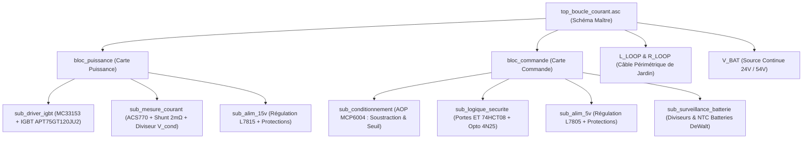

# Architecture Hiérarchique & Spécification des Blocs LTspice

Ce document décrit la structure modulaire arborescente du projet LTspice. Le principe directeur est la **décomposition en couches successives** (Bloc Principal → Sous-Blocs → Sous-Sous-Blocs) de manière à ce que le schéma maître (`top_boucle_courant.asc`) ne présente qu'une lisibilité maximale en tant que diagramme synoptique opérationnel.

---

## 1. Arborescence Synoptique des Blocs

---

## 2. Spécification des Blocs et Interfaces de Broches

Tous les symboles hiérarchiques respectent la norme **Cas 3** de LTspice :
- `SymbolType: Block`
- Champs attributs (`Prefix`, `Value`, `ModelFile`) laissés entièrement vides.
- Les noms de broches du symbole `.asy` correspondent strictement aux ports `IOPIN` du schéma `.asc`.

---

### 2.1 Bloc Maître : `top_boucle_courant.asc`

Le schéma supérieur regroupe les deux grands blocs (`bloc_puissance` et `bloc_commande`) interconnectés par le faisceau 10 broches équivalent aux connecteurs J1/J8 du matériel physique.

**Raccordements extérieurs au schéma maître :**
- `V_BAT` : Source d'énergie continue (24V nominal, configurable de 18V à 54V).
- `L_LOOP` & `R_LOOP` : Modèle de la boucle de câble périphérique déployée dans le jardin (typiquement $L = 500\,\mu\text{H}$ à $2\,\text{mH}$, $R = 2\,\Omega$ à $10\,\Omega$).
- Masse globale `0` (`GND`).

---

### 2.2 Bloc Puissance : `bloc_puissance.asc` / `.asy`

Ce bloc englobe toute l'électronique de forte puissance et ses capteurs associés.

#### Interface des Ports du Symbole `bloc_puissance.asy`

| Broche | Type | Description |
| :--- | :--- | :--- |
| `+24V_IN` | Entrée | Alimentation continue de puissance issue de la batterie. |
| `GND_PWR` | Entrée/Masse | Référence de masse de puissance principale (`GND1` / `K_GND`). |
| `+BOUCLE` | Sortie | Connexion au départ du câble périphérique de tondeuse. |
| `-BOUCLE` | Entrée | Retour du câble périphérique traversant le capteur de courant. |
| `PWM_OPTO_IN` | Entrée | Signal de commande PWM isolé en provenance de la carte commande. |
| `+15V_OUT` | Sortie | Rail 15V régulé pour alimenter la commande (via U1). |
| `+5V_IN` | Entrée | Rail 5V provenant de la carte commande pour alimenter l'ACS770 et le DS18B20. |
| `V_CPT_HALL` | Sortie | Signal analogique de tension proportionnel au courant mesuré par l'ACS770. |
| `SENS_I` | Sortie | Signal analogique de tension différentielle aux bornes du shunt Kelvin 2 mΩ. |
| `V_COND` | Sortie | Image atténuée de la tension collecteur IGBT (surveillance haute tension). |
| `FAULT_IGBT` | Sortie | Signal d'alarme logique en cas de désaturation de l'IGBT (court-circuit). |
| `TEMP_PWR` | Sortie | Ligne de données 1-Wire du capteur de température DS18B20. |
| `GNDD` | Sortie/Masse | Masse de référence signaux / logique de la carte puissance. |

#### Sous-blocs Internes de `bloc_puissance` :
1. **`sub_driver_igbt.asc` / `.asy` :**
   - Intègre le driver MC33153, le réseau de commande de grille ($R_{g,on} = 15\,\Omega$, $R_{g,off} = 4.7\,\Omega$ avec diode rapide), l'IGBT APT75GT120JU2, le condensateur de masquage de désaturation $C_3 = 10\,\mu\text{F}$, et la diode haute tension $D_6$.
2. **`sub_mesure_courant.asc` / `.asy` :**
   - Modélise le capteur Hall ACS770 ($80\,\text{mV/A}$, bande passante $120\,\text{kHz}$), le shunt 4 bornes de $2\,\text{m}\Omega$, et la chaîne d'atténuation capacitive/résistive $R_8$–$R_{13}$ ($216\,\text{k}\Omega / 5\,\text{k}\Omega$).
3. **`sub_alim_15v.asc` / `.asy` :**
   - Régulateur linéaire L7815 avec diode anti-retour, diode TVS B320, et condensateurs de filtrage $10\,\mu\text{F}$.

---

### 2.3 Bloc Commande : `bloc_commande.asc` / `.asy`

Ce bloc réunit le conditionnement analogique, la logique de décision ultra-rapide et l'isolation galvanique.

#### Interface des Ports du Symbole `bloc_commande.asy`

| Broche | Type | Description |
| :--- | :--- | :--- |
| `+15V_IN` | Entrée | Rail 15V provenant de la carte puissance (sur J1 pin 1). |
| `GNDD_IN` | Entrée/Masse | Masse de puissance retour provenant du connecteur J1. |
| `PWM_MCU_IN` | Entrée | Signal logique PWM généré par le microcontrôleur Arduino (broche D9). |
| `V_CPT_HALL_IN`| Entrée | Signal de mesure du capteur Hall provenant de la puissance. |
| `SENS_I_IN` | Entrée | Signal de mesure du shunt de puissance provenant de la puissance. |
| `V_COND_IN` | Entrée | Mesure atténuée de la tension collecteur IGBT. |
| `FAULT_IN` | Entrée | Signal de défaut désaturation IGBT. |
| `PWM_OPTO_OUT`| Sortie | Signal PWM isolé collecteur ouvert tiré au 15V pour attaquer le driver MC33153. |
| `+5V_OUT` | Sortie | Rail 5V régulé renvoyé vers la carte puissance et les capteurs. |
| `I_MAX_INT_OUT`| Sortie | Signal d'interruption matérielle vers Arduino (D3) indiquant le dépassement de courant. |
| `I_HALL_ADC` | Sortie | Sortie analogique calibrée pour l'ADC Arduino (A1). |
| `I_SHUNT_ADC` | Sortie | Sortie analogique calibrée du shunt pour l'ADC Arduino (A2). |
| `GND_LOGIC` | Entrée/Masse | Masse locale de commande `GND`. |

#### Sous-blocs Internes de `bloc_commande` :
1. **`sub_conditionnement.asc` / `.asy` :**
   - Étage à quadruple AOP MCP6004 :
     - Étage $U_{2A}$ : Amplificateur différentiel soustracteur ($G = 1$) avec réjection du mode commun pour le capteur Hall.
     - Étage $U_{2D}$ : Amplificateur différentiel pour le shunt Kelvin.
     - Étage $U_{2C}$ : Étage d'amplification optionnel ($G = 2$).
     - Étage $U_{2B}$ : Comparateur à seuil rapide comparant le courant mesuré à la consigne du potentiomètre $RV_1$.
2. **`sub_logique_securite.asc` / `.asy` :**
   - Portes logiques ET 74HCT08 et optocoupleur 4N25 :
     - La porte ET verrouille le passage du PWM Arduino dès que le comparateur détecte une surintensité.
     - L'optocoupleur 4N25 transmet le signal validé vers le domaine 15V de puissance avec isolation galvanique totale.
3. **`sub_alim_5v.asc` / `.asy` :**
   - Régulateur L7805 avec protection TVS SM6T22A et filtrage $10\,\mu\text{F}$.
4. **`sub_surveillance_batterie.asc` / `.asy` :**
   - Ponts diviseurs de mesure de tension (27k/1k) et réseaux de polarisation de thermistance CTN pour packs batteries DeWalt.

